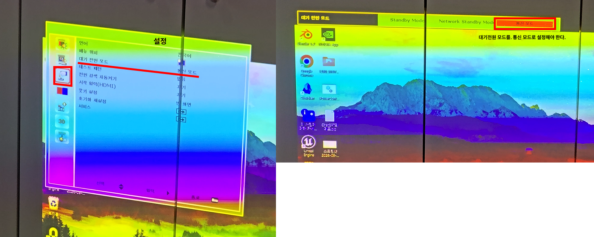

# PowerController

외부장치의 의 전원을 LAN으로 제어하는 Windows용 프로그램입니다.  
PJLink Class 1 프로토콜을 사용하며, GUI에서 여러 프로젝터를 관리하거나 명령행에서 특정 프로젝터의 전원을 켜고 끌 수 있습니다.

테스트는 Barco G60-W10 빔프로젝터 를 대상으로 이루어졌습니다.

## 주요 기능

- 프로젝터 이름, IP 주소, PJLink 포트 등록
- 등록한 여러 프로젝터의 전원 상태 표시
- 프로젝터별 전원 ON/OFF 및 수동 새로고침
- 프로그램 시작 시 및 10초 간격으로 상태 자동 갱신
- PJLink 비밀번호 인증 지원
- Windows 로그인 시 지정한 프로젝터 자동 켜기

등록한 프로젝터 목록은 Windows 사용자 설정에 저장되지만 PJLink 비밀번호는 저장되지 않습니다.

## 사전 준비

### 네트워크 및 프로젝터

1. 제어 PC와 빔프로젝터를 LAN으로 연결합니다.
2. 두 장비가 같은 서브넷에 있도록 고정 IP를 설정합니다.
   - 제어 PC 예시: `192.168.0.99`
   - 빔프로젝터 예시: `192.168.0.100`
3. 빔프로젝터 설정에서 대기 중에도 네트워크 통신이 가능한 전원 모드를 사용합니다.

4. PJLink/LAN 제어를 활성화합니다.
5. PJLink 포트를 확인합니다. 기본값은 TCP `4352`입니다.

프로젝터 메뉴의 정확한 항목 이름은 펌웨어나 언어 설정에 따라 다를 수 있습니다.

### 제어 PC

- Windows
- Python 3.11
- `uv`

프로젝트는 Python `3.11 이상, 3.12 미만`을 요구합니다.

## 설치

원하는 위치에 이 프로젝트를 복사합니다. 자동 시작 기능을 사용할 경우 경로가 바뀌지 않는 위치를 권장합니다.

```powershell
cd C:\PowerController
uv sync
```

`uv sync`는 `.venv` 가상환경을 만들고 PyQt6 등 필요한 패키지를 설치합니다.

## GUI 실행

`PowerController_App.bat`을 더블클릭합니다. `.venv`가 없으면 처음 실행할 때 `uv sync`를 자동으로 수행합니다.

또는 PowerShell에서 실행할 수 있습니다.

```powershell
uv run python main.py
```

프로그램에서 이름, IP 주소와 포트를 입력한 뒤 **IP 등록**을 누릅니다. PJLink 인증을 사용하는 경우 공통 비밀번호 입력란에 비밀번호를 입력합니다.

## 명령행 실행

GUI 없이 한 대의 프로젝터에 전원 명령을 보낼 수 있습니다.

```powershell
# 전원 켜기
uv run python main_2.py --ip 192.168.0.100 --port 4352 --on

# 전원 끄기
uv run python main_2.py --ip 192.168.0.100 --port 4352 --off
```

지원 옵션은 다음과 같습니다.

| 옵션 | 설명 | 기본값 |
| --- | --- | --- |
| `--ip` | 프로젝터 IP 주소(필수) | - |
| `--port` | PJLink TCP 포트 | `4352` |
| `--on` | 전원 ON 명령 | - |
| `--off` | 전원 OFF 명령 | - |
| `--password` | PJLink 비밀번호 | 빈 문자열 |
| `--retries` | 실패 시도를 포함한 최대 시도 횟수 | `1` |
| `--delay` | 재시도 사이의 대기 시간(초) | `5` |

`--on`과 `--off` 중 하나만 지정해야 합니다.

## Windows 로그인 시 프로젝터 자동 켜기

1. 먼저 프로젝트 폴더에서 `uv sync`를 실행해 `.venv`를 생성합니다.
2. `PowerController_IP_Startup.bat`을 텍스트 편집기로 엽니다.
3. 파일 상단의 값을 실제 환경에 맞게 수정합니다.

   ```bat
   set "PROJECTOR_IP=192.168.0.100"
   set "PROJECTOR_PORT=4352"
   set "PROJECT_DIR=C:\PowerController"
   ```

4. 수정한 BAT 파일을 더블클릭해 정상적으로 전원이 켜지는지 먼저 확인합니다.
5. `Win + R`을 누르고 `shell:startup`을 입력합니다.
6. 열린 시작프로그램 폴더에 `PowerController_IP_Startup.bat`의 **바로가기**를 만듭니다.

로그인 시 전원 켜기를 최대 5회 시도하며, 실패하면 5초 후 다시 시도합니다. 실행 결과는 프로젝트 폴더의 `startup_power.log`에 기록됩니다.

> BAT 파일만 다른 폴더로 복사해도 실행할 수 있지만, `PROJECT_DIR`은 반드시 `main_2.py`와 `.venv`가 있는 실제 프로젝트 절대 경로여야 합니다.

## 문제 해결

- **연결할 수 없음**: PC와 프로젝터의 IP/서브넷, LAN 연결, 프로젝터의 통신 모드를 확인합니다.
- **연결 시간 초과**: Windows 방화벽과 네트워크 장비에서 TCP 4352(또는 설정한 포트)가 차단되지 않았는지 확인합니다.
- **비밀번호 오류**: 프로젝터의 PJLink 비밀번호와 GUI의 공통 비밀번호 또는 `--password` 값이 같은지 확인합니다.
- **자동 시작이 동작하지 않음**: `PROJECT_DIR`과 `.venv\Scripts\python.exe`의 존재 여부를 확인하고 `startup_power.log`를 살펴봅니다.
- **전원이 꺼진 상태에서 통신 불가**: 프로젝터의 대기 전원 설정을 네트워크 제어가 가능한 모드로 변경합니다.

## 파일 구성

| 파일 | 역할 |
| --- | --- |
| `main.py` | GUI 프로그램 진입점 |
| `power_controller.py` | PyQt6 화면 및 프로젝터 목록 관리 |
| `pjlink.py` | PJLink 통신과 인증 처리 |
| `main_2.py` | 명령행 전원 제어 프로그램 |
| `PowerController_App.bat` | GUI 간편 실행 및 최초 환경 구성 |
| `PowerController_IP_Startup.bat` | Windows 로그인 시 프로젝터 전원 ON |
| `pyproject.toml`, `uv.lock` | Python 버전 및 의존성 정의 |

## 보안 참고

PJLink 비밀번호를 BAT 파일이나 공유 문서에 평문으로 기록하지 마세요. 자동 시작 BAT는 현재 비밀번호 인자를 전달하지 않으므로, PJLink 인증이 활성화된 환경에서는 별도의 안전한 자격 증명 관리 방식을 사용하는 것이 좋습니다.
